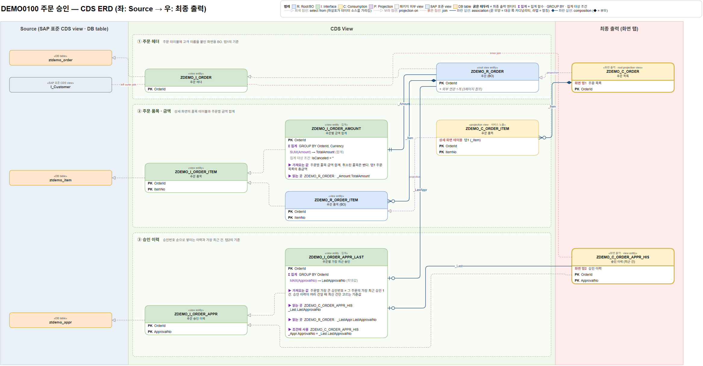

# sap-cds-erd-skill

SAP RAP 프로그램(패키지) 하나를 지정하면, 로컬에 받아 둔 abapGit 소스와 Fiori 프론트엔드를 읽어 **CDS view ERD를 draw.io 파일로 그려 주는 Claude Code 스킬**입니다.

> **English** — A Claude Code skill that draws a CDS-view ERD (`.drawio` + PNG/PDF) for one SAP RAP program from local abapGit sources and its Fiori app: data sources on the left, CDS views in the middle (grouped by business function), screen entities on the right, with every aggregating view explained. The skill text, script messages and diagram labels are in Korean.



*`examples/demo-project`(가상의 "주문 승인" 프로그램)로 만든 결과입니다. 원본 파일: [ZDEMO0100-erd.drawio](examples/demo-project/sample-output/ZDEMO0100-erd.drawio) · [ZDEMO0100-erd.pdf](examples/demo-project/sample-output/ZDEMO0100-erd.pdf)*

## 무엇을 그리나

- **왼쪽에서 오른쪽으로 3구역.** Source(SAP 표준 CDS view · DB 테이블) → CDS View → 최종 출력(화면 탭). 구역은 배경색으로 구분합니다.
- **최종 출력은 화면 기준.** 프론트엔드의 manifest와 annotation을 읽어, 탭이 실제로 띄우는 엔터티만 맨 오른쪽 열에 놓습니다. 프론트엔드가 없으면 서비스 정의를 기준으로 잡습니다.
- **가운데는 기능별 세부 구역.** OpenWiki 페이지 · basic-memory 노트 · 로컬 스펙 문서에서 기능 단위가 확인될 때만 나눕니다. 근거가 없으면 나누지 않습니다.
- **집계 view에는 설명이 붙습니다.** GROUP BY · 집계 함수 · 조건은 소스에서 자동으로 뽑고, 그 값이 업무적으로 무엇인지("▶ 가져오는 값")는 문서를 읽고 적습니다. 그 값을 읽는 view와 조건도 함께 표시합니다.
- **관계 종류를 선 모양으로 구분.** select from, projection, join, association(카디널리티 포함), composition.
- **결과물**은 draw.io에서 계속 고칠 수 있는 `.drawio` 파일과 PNG · PDF입니다. 페이지는 최대 3장입니다: ① View 관계 ② Abstract 엔터티(액션 파라미터) ③ 외부 연관 표.

## 동작 방식

스크립트는 소스에서 **사실**을 뽑고 위치를 계산합니다. 문서를 읽어야 아는 **해석**은 Claude가 설정 파일에 적습니다.

| 단계 | 하는 일 | 주체 |
|---|---|---|
| 1 | 화면에 뜨는 엔터티 확인 → `screen.json` | `scripts/frontend_screen.py` |
| 2 | 저장소 전체를 색인해 관계 · 집계 · 사용처 추출 → `model.json` | `scripts/cds_model.py` |
| 3 | 프로그램 관련 문서 조사 | Claude (OpenWiki + basic-memory + 로컬 문서) |
| 4 | 기능 구분과 집계 값의 의미 작성 → `sections.json` | Claude |
| 5 | 배치 계산 후 draw.io 파일 생성 | `scripts/build_erd.py` → `cli-anything-drawio` |
| 6 | 파일 검사, PNG · PDF 내보내기, 그림을 직접 열어 확인 | Claude |
| 7 | 근거와 한계를 포함해 보고 | Claude |

전체 절차는 [skills/drawing-program-erd/SKILL.md](skills/drawing-program-erd/SKILL.md)에 있습니다.

## 사전 요구사항

| 항목 | 조건 | 용도 |
|---|---|---|
| [Claude Code](https://claude.com/claude-code) | 스킬 · 플러그인을 지원하는 버전 | 스킬 실행 |
| Python | 3.10 이상 | 스크립트(표준 라이브러리만 사용)와 CLI |
| [draw.io 데스크톱](https://github.com/jgraph/drawio-desktop/releases) | 24.7.17에서 검증 | PNG · PDF 내보내기 |
| `cli-anything-drawio` | 이 저장소의 `tools/`에 들어 있음 | `.drawio` 생성 · 검사 · 내보내기 |
| [basic-memory](https://github.com/basicmachines-co/basic-memory) MCP | 1.0 이상 (`bm_project`, `bm_search`, `bm_read` 도구), Claude Code에 연결된 상태 | 프로그램 관련 문서 검색 |
| OpenWiki (선택) | 소스 저장소에 `openwiki/` 폴더가 있는 경우. openwiki MCP가 연결되어 있으면 검색에 사용 | 프로그램 관련 문서 조사(가장 먼저 읽음) |
| 백엔드 소스 | abapGit 형식의 `src` 폴더가 로컬에 있어야 함 | 분석 대상 |
| 프론트엔드 소스 (선택) | UI5 / Fiori elements 앱 폴더 (`webapp/manifest.json`) | 화면 탭 확인 |
| Pillow (선택) | `pip install pillow` | 넓은 그림을 잘라서 확인 |

**basic-memory에 대해.** 스킬의 3단계가 basic-memory 볼트에서 프로그램 스펙 · 설계 노트를 찾습니다. OpenWiki가 없으면 가운데 구역을 기능별로 나누는 근거가 주로 여기서 나오므로, 프로그램 문서를 볼트에 넣어 두어야 스킬이 제 성능을 냅니다. 연결되어 있지 않으면 스킬은 그 사실을 알리고 로컬 문서만으로 진행하며, 근거를 찾지 못하면 가운데 구역을 나누지 않고 그립니다.

**OpenWiki에 대해.** 소스 저장소에 OpenWiki(`openwiki/` 폴더)가 있으면 3단계에서 가장 먼저 읽습니다. 모듈 페이지와 아키텍처 페이지에 정리된 처리 단계 · BO 구조 · 프로그램 간 관계가 기능 구분과 집계 설명의 실마리가 됩니다. 스킬은 위키와 `src`를 그대로 믿고 씁니다. 그러므로 **스킬을 쓰기 전에 위키를 `src`에 맞춰 최신으로 갱신해 두어야 합니다.** abapGit으로 소스를 새로 받아도 위키는 저절로 갱신되지 않으며, `openwiki code --update`를 직접 실행하거나 저장소의 갱신 워크플로가 돌아야 갱신됩니다.

## 설치

### 1. 저장소 받기

```bash
git clone https://github.com/YUSHINSHUB/sap-cds-erd-skill.git
cd sap-cds-erd-skill
```

### 2. draw.io 데스크톱 설치

```bash
winget install JGraph.Draw        # Windows
brew install --cask drawio        # macOS
snap install drawio               # Linux
```

### 3. draw.io CLI 설치

```bash
pip install ./tools/cli-anything-drawio
cli-anything-drawio backend info
```

`found: yes`와 draw.io 버전이 나오면 됩니다.

- `cli-anything-drawio` 명령을 찾을 수 없다고 나오면 pip의 Scripts 폴더가 PATH에 없는 것입니다. `python -c "import sysconfig; print(sysconfig.get_path('scripts'))"`(Windows 사용자 설치는 `sysconfig.get_path('scripts','nt_user')`)가 알려 주는 폴더를 PATH에 추가하세요. 추가하지 않아도 스킬은 실행 파일의 전체 경로를 찾아서 씁니다.
- draw.io를 기본 위치가 아닌 곳에 설치했다면 환경 변수 `DRAWIO_PATH`에 실행 파일 경로를 지정합니다.

### 4. 스킬 등록

둘 중 하나를 고릅니다.

**A. 플러그인으로 설치** — Claude Code 안에서 실행합니다.

```
/plugin marketplace add YUSHINSHUB/sap-cds-erd-skill
/plugin install sap-cds-erd@sap-cds-erd-skill
```

GitHub 대신 클론한 폴더를 그대로 쓰려면 `/plugin marketplace add <클론한 폴더 경로>`로 등록합니다. 스킬 이름은 `sap-cds-erd:drawing-program-erd`가 됩니다.

**B. 스킬 폴더만 복사**

```bash
# macOS / Linux
cp -r skills/drawing-program-erd ~/.claude/skills/
```

```powershell
# Windows PowerShell
Copy-Item -Recurse skills\drawing-program-erd "$env:USERPROFILE\.claude\skills\"
```

Claude Code를 다시 시작하면 스킬 목록에 `drawing-program-erd`가 보입니다.

### 5. basic-memory 연결

이미 쓰고 있다면 건너뜁니다. 처음이라면 [basic-memory 문서](https://docs.basicmemory.com)를 따라 Claude Code에 MCP 서버로 연결하고, 프로그램 스펙 · 설계 문서를 볼트에 넣어 둡니다.

## 설치 확인 — 데모 실행

Claude 없이 스크립트와 CLI만으로 데모 ERD를 만들어 봅니다. 저장소 루트에서 시작합니다.

```bash
cd examples/demo-project
python ../../skills/drawing-program-erd/scripts/frontend_screen.py backend/src/zdemo010/zdemo0100 out/work/screen.json frontend/zfrdemo0100
python ../../skills/drawing-program-erd/scripts/cds_model.py backend/src backend/src/zdemo010/zdemo0100 out/work/screen.json out/work/model.json
python ../../skills/drawing-program-erd/scripts/build_erd.py out/work/model.json sections.json cli-anything-drawio out/ZDEMO0100-erd.drawio out/work/commands.txt
cli-anything-drawio --project out/ZDEMO0100-erd.drawio project check
cli-anything-drawio --project out/ZDEMO0100-erd.drawio export render out/ZDEMO0100-erd.png --page 0 --overwrite
```

기대하는 출력:

- 1번: `frontend: Fiori Elements (2 tab)`과 `tab1: ZDEMO_C_ORDER`, `tab2: ZDEMO_C_ORDER_APPR_HIS`
- 2번: `AGGREGATION` 블록 2개 (`ZDEMO_I_ORDER_AMOUNT`, `ZDEMO_I_ORDER_APPR_LAST`)
- 3번: 마지막 줄 `exit: 0  error lines: 0`
- 4번: `ok: yes`
- 5번: `verified: yes`, 그리고 `out/ZDEMO0100-erd.png`가 위의 그림과 같음

`sections.json`은 4단계에서 Claude가 쓰는 파일입니다. 데모에는 [가상의 스펙 문서](examples/demo-project/docs/주문승인-기능정의.md)를 근거로 미리 써 두었습니다.

## 사용법

Claude Code에서 프로그램 ID나 패키지를 주고 ERD를 요청합니다.

```
ZDEMO0100 ERD 만들어줘. 백엔드 소스는 D:\abap\my-repo\src, 프론트엔드는 D:\ui5\zfrdemo0100, 결과는 D:\erd 에 저장해줘.
```

```
이 프로그램 CDS view가 테이블에서 화면까지 어떻게 이어지는지 그림으로 보여줘.
```

경로를 말하지 않으면 스킬이 백엔드 `src` 폴더와 출력 폴더를 묻습니다. 프론트엔드 폴더는 패키지의 서비스 정의 이름으로 직접 찾아봅니다.

출력 폴더에 생기는 파일:

| 파일 | 내용 |
|---|---|
| `<프로그램>-erd.drawio` | ERD 원본. draw.io에서 열어 고칠 수 있음 |
| `<프로그램>-erd-p1.png` | 1페이지 그림 |
| `<프로그램>-erd.pdf` | 전체 페이지 |
| `work/screen.json`, `work/model.json`, `work/sections.json`, `work/commands.txt` | 중간 파일. `sections.json`을 고친 뒤 5단계만 다시 실행하면 그림이 바뀜 |

## 그림 읽는 법

| 표시 | 뜻 |
|---|---|
| 파란 배경 / 초록 배경 / 붉은 배경 | Source / CDS View / 최종 출력 구역 |
| 초록 점선 상자 | 가운데 구역의 기능별 세부 구역 |
| 상자 색 | 파랑 R(Root · BO), 초록 I(Interface), 노랑 C(Consumption), 보라 P(Projection), 주황 DB 테이블, 회청색 SAP 표준 view |
| 굵은 테두리 | 최종 출력 엔터티 (`화면 탭N` 표시) |
| 점선 테두리 | 패키지 밖의 view |
| 회색 점선 화살표 | `select from` (화살표가 데이터 소스를 가리킴) |
| 보라 점선 화살표 | `projection on` |
| 붉은 점선 | `join` |
| 파란 실선 | association (끝 모양 = 대상 쪽 카디널리티, 라벨 = 별칭) |
| 파란 실선 + ◆ | composition (◆ 쪽이 부모) |
| `Σ 집계` | 집계 view. GROUP BY, 집계 함수, 조건, ▶ 가져오는 값, ▶ 읽는 곳 |

## 설정 파일

| 파일 | 만드는 주체 | 내용 |
|---|---|---|
| `screen.json` | `frontend_screen.py`가 초안 작성, 필요하면 수정 | 화면 탭, 상세 화면 테이블, 앱이 직접 읽는 엔터티 |
| `sections.json` | Claude가 문서를 읽고 작성 | 기능별 구역(`sections`), 집계 값의 의미(`aggregation_notes`), 근거(`evidence`) |

형식은 [reference/config-format.md](skills/drawing-program-erd/reference/config-format.md), 예시는 [examples/](skills/drawing-program-erd/examples)에 있습니다.

## 한계

- CDS 소스를 정규식으로 읽습니다. `select from`, `projection on`, `join`, `union`, `association`, `composition`, `redirected to`, 집계 함수, `group by`, `where`, join의 `on`을 인식합니다. 문법 파서가 아니므로 특이한 형태는 놓칠 수 있습니다.
- 로컬 abapGit 소스 기준입니다. 시스템의 현재 상태와 다를 수 있습니다.
- union view는 첫 번째 select의 키 · 집계 · 조건만 봅니다. 데이터 원천은 모든 branch를 따라갑니다.
- 상자 색은 view 이름의 `Z<모듈>_<R|I|C|P>_…` 규칙으로 정합니다. 다른 이름 규칙이면 모두 Interface 색으로 나옵니다.
- Fiori elements 앱은 탭을 자동으로 찾습니다. 프리스타일 UI5 앱은 Claude가 view XML과 컨트롤러를 읽고 탭을 직접 적습니다.
- 스킬 문서, 스크립트 메시지, 그림의 라벨은 한국어입니다.
- Windows 11, Python 3.11, draw.io 24.7.17에서 검증했습니다. macOS와 Linux는 draw.io 실행 파일 탐색까지 구현되어 있지만 검증하지 않았습니다. 화면이 없는 Linux에서는 `xvfb-run`으로 실행해야 합니다.

## 저장소 구조

```
sap-cds-erd-skill/
├─ .claude-plugin/
│  ├─ plugin.json                 플러그인 정의
│  └─ marketplace.json            마켓플레이스 정의 (이 저장소 = 플러그인 1개)
├─ skills/drawing-program-erd/    스킬 본체 (이 폴더만 복사해도 동작)
│  ├─ SKILL.md                    절차
│  ├─ reference/config-format.md  설정 파일 형식
│  ├─ examples/                   데모의 screen.json, sections.json
│  └─ scripts/                    frontend_screen.py, cds_model.py, build_erd.py
├─ tools/cli-anything-drawio/     draw.io CLI (pip 패키지)
├─ examples/demo-project/         가상의 "주문 승인" 프로그램
│  ├─ backend/src/                abapGit 형식 CDS · 테이블
│  ├─ frontend/zfrdemo0100/       Fiori elements 앱 (manifest, annotation, i18n)
│  ├─ docs/                       가상의 기능 정의 문서
│  ├─ sections.json               기능 구분 · 집계 설명
│  └─ sample-output/              만들어 둔 결과 (.drawio, .pdf, 중간 파일)
├─ docs/demo-erd.png
├─ LICENSE                        MIT
├─ THIRD_PARTY_NOTICES.md
└─ README.md
```

## draw.io CLI만 따로 쓰기

`cli-anything-drawio`는 ERD와 무관하게 쓸 수 있는 범용 draw.io CLI입니다. 도형 · 연결선 · 페이지 · 레이어 편집, 실행 취소, PNG · JPG · SVG · PDF · VSDX 내보내기를 지원합니다. 사용법은 [tools/cli-anything-drawio/cli_anything/drawio/README.md](tools/cli-anything-drawio/cli_anything/drawio/README.md)를 보세요.

테스트를 돌리려면:

```bash
pip install pytest
python -m pytest tools/cli-anything-drawio/cli_anything/drawio/tests -v
```

E2E 테스트는 draw.io 데스크톱이 설치되어 있어야 통과합니다.

## 라이선스

[MIT](LICENSE). 단, `tools/cli-anything-drawio/cli_anything/drawio/utils/repl_skin.py` 한 파일은 Apache-2.0입니다([THIRD_PARTY_NOTICES.md](THIRD_PARTY_NOTICES.md)).

## 출처

- `tools/cli-anything-drawio`는 [HKUDS/CLI-Anything](https://github.com/HKUDS/CLI-Anything)의 방법론으로 만든 CLI이고, 그 프로젝트의 `repl_skin.py`(Apache-2.0)를 포함합니다. 자세한 내용은 [THIRD_PARTY_NOTICES.md](THIRD_PARTY_NOTICES.md)에 있습니다.
- draw.io는 JGraph의 제품이며 이 저장소에 들어 있지 않습니다.
- `examples/demo-project`의 객체와 문서는 모두 가상의 예시입니다.
